# Live Upstox Reception, Bounded Decoding and Allocation Audits
### A low-latency C++ market-data engine with a rule-based trading strategy, extended with ML/DL

> **Project type:** Minor project (proposal)
> **Language:** C++20 (core engine), Python (research and model training)
> **Mode:** Paper trading and replay only. No real orders are placed.

---

## 1. Abstract

Modern trading systems depend on two things: **fast, predictable data handling** and **disciplined decision-making**. This project builds both at student scale.

1. A **C++ ingestion engine** receives live market data from the Upstox WebSocket feed, decodes only the fields it needs (*bounded decoding*), stores them in fixed-capacity buffers, and proves that the hot path performs **no heap allocations** (*allocation audits*).
2. On top of that, a **simple, classical trading strategy** based on **Order Book Imbalance (OBI)** generates signals from the live order book. This is the baseline.
3. The **same features** are then used to train **ML and DL models** (Logistic Regression, LightGBM, LSTM/TCN). We test whether they beat the rule-based baseline once transaction costs are included.
4. A **risk gate** (position limits, rate limits, kill switch) sits between every signal and every simulated order.

The main question the project answers is:

> *Does a machine-learning model add measurable value over a simple, explainable microstructure rule, and at what latency and complexity cost?*

---

## 2. Motivation

The literature on AI-driven algorithmic trading shows a consistent pattern. Automated strategies improve liquidity and speed under normal conditions, but **correlated signals, opaque models and missing real-time controls** can amplify instability during stress (Ogbuonyalu et al., 2024). That review recommends transparent models, real-time monitoring, stress testing and kill switches.

This project applies those recommendations at small scale:

| Concern raised in the literature | How this project responds |
|---|---|
| Opaque "black-box" models | Start with a fully explainable rule; use SHAP to explain ML models |
| Correlated, fragile strategies | Compare ML against a simple baseline instead of assuming ML is better |
| No real-time oversight | Risk gate, kill switch and live metrics dashboard |
| Overfitted backtests | Time-ordered, walk-forward validation; costs included |
| Latency and infrastructure ignored | Measured latency and a zero-allocation hot path |

---

## 3. Objectives

1. Build a C++ engine that ingests the Upstox WebSocket feed with **bounded memory** and **measured latency**.
2. Demonstrate, with tests, that the steady-state hot path makes **zero heap allocations**.
3. Reconstruct a top-of-book / top-N-levels view and compute microstructure features in real time.
4. Implement a **rule-based Order Book Imbalance strategy** and evaluate it with a cost-aware backtest.
5. Train ML/DL models on the same features and **compare them fairly** against the baseline.
6. Add a **risk and safety layer** and show it working in a stress-replay test.

### Out of scope
Real order placement, co-location or kernel-bypass networking, multi-venue arbitrage, and any claim of production-grade HFT performance.

---

## 4. System architecture

### 4.1 High-level diagram

```mermaid
flowchart LR
    subgraph SRC[Data sources]
        A1[Upstox WebSocket feed - live]
        A2[Replay files - recorded ticks]
    end

    subgraph CORE[C++ core engine - pinned threads]
        B[Network thread: TLS WebSocket receive]
        C[(SPSC ring buffer 1 - fixed capacity raw frames)]
        D[Decoder thread: selective Protobuf decode]
        E[Normalizer: MarketTick struct]
        F[Order book state and feature engine]
        G[Signal engine: Stage 1 OBI rule or Stage 2 ML model]
        H[Risk gate: limits, throttle, kill switch]
        I[Paper execution simulator]
        J[Async writer: Parquet tick store]
    end

    subgraph RES[Python research - offline]
        K[Load Parquet: Polars / DuckDB]
        L[Labels and feature selection]
        M[Train: LogReg, LightGBM, LSTM/TCN]
        N[Walk-forward validation and backtest]
        O[Export ONNX and SHAP report]
    end

    subgraph OBS[Observability]
        P[Prometheus metrics]
        Q[Grafana dashboard]
    end

    A1 --> B
    A2 --> B
    B --> C --> D --> E --> F --> G --> H --> I
    E --> J
    J --> K --> L --> M --> N --> O
    O -. ONNX model .-> G
    B -. latency stamps .-> P
    F -. latency stamps .-> P
    I --> P --> Q
```



### 4.2 Component responsibilities

| # | Component | Responsibility | Key design choice |
|---|---|---|---|
| 1 | **Feed handler** | Connect to Upstox WSS, receive binary frames, reconnect on failure | One interface for live and replay sources, so both share the same downstream code |
| 2 | **Ring buffer** | Hand raw frames from network thread to decoder thread | Lock-free single-producer/single-consumer queue, fixed capacity, cache-line padded |
| 3 | **Bounded decoder** | Parse Protobuf frames | Decode only the needed fields (LTP, best bid/ask, depth, volume) for subscribed instruments; reject oversized frames |
| 4 | **Normalizer** | Convert decoded data into a fixed-size `MarketTick` struct | Plain-old-data struct, no pointers, no `std::string` on the hot path |
| 5 | **Order book and features** | Maintain top-N levels per instrument and compute features per update | Flat arrays, pre-allocated per instrument |
| 6 | **Signal engine** | Produce BUY / SELL / HOLD | Stage 1: rule. Stage 2: ML model through ONNX Runtime |
| 7 | **Risk gate** | Approve or block every signal | Max position, max loss, order-rate limit, kill switch |
| 8 | **Paper execution simulator** | Fill orders against the observed book with a cost model | Conservative fills (cross the spread), configurable costs |
| 9 | **Tick store** | Persist normalized ticks | Background thread writes Parquet; the hot path never waits on disk |
| 10 | **Metrics** | Export latency and system health | Prometheus counters and histograms, Grafana panels |

### 4.3 Threading model

| Thread | Role | Rule |
|---|---|---|
| T1 Network | Receive frames, timestamp on arrival, push to ring buffer | Never blocks on downstream |
| T2 Decode and book | Pop frames, decode, update book, compute features | No heap allocation after warm-up |
| T3 Signal and risk | Evaluate strategy, apply risk gate, simulate orders | Reads features, writes orders |
| T4 Writer | Drain a second queue to Parquet | May be slow; never blocks T2 |

If a queue is full, the **overflow policy is drop-and-count** (never grow memory), and the drop counter is exported as a metric.

### 4.4 Bounded decoding and allocation audits

These two ideas are the engineering core of the project.

**Bounded decoding**
- Only the Protobuf fields required by the strategy are read; everything else is skipped.
- Maximum frame size, maximum instruments and maximum depth levels are compile-time or startup-time constants.
- Malformed or oversized frames are counted and discarded, never crash the engine.

**Allocation audit**
- All buffers (ring buffers, order books, feature windows) are allocated **once at startup**.
- In test builds, `operator new` and `malloc` are instrumented with a counter.
- An automated test runs a warm-up phase, resets the counter, replays a large recorded session, and **asserts the allocation count is zero**.
- Heap profiling tools (e.g. `heaptrack` or Valgrind) are used as a second check.

### 4.5 Latency measurement

Timestamps are taken at each stage boundary with a monotonic clock:

```
t0 frame received -> t1 decoded -> t2 book updated -> t3 features ready -> t4 signal produced
```

We report **p50, p99 and p99.9** for each segment (`t1-t0`, `t2-t1`, ...) and for tick-to-signal overall.

> **Important:** over a public internet WebSocket, network delay dominates. We therefore report **internal** processing latency (from frame arrival onward) and do not claim end-to-end exchange latency. Latency targets are *goals to be measured*, not guarantees.

---

## 5. Trading strategy

The strategy is built in two stages. **Stage 1 is a simple rule-based strategy** that is easy to explain and has a clear microstructure rationale. **Stage 2 replaces the hand-written rule with learned models** using the same inputs.

### 5.1 Stage 1: Order Book Imbalance (OBI) strategy

**Idea.** The limit order book shows how much volume is waiting to buy (bids) versus sell (asks). If much more volume is waiting to buy than to sell, upward price pressure is more likely in the very short term; the reverse suggests downward pressure. Order-book imbalance and order flow imbalance are well-studied short-horizon predictors of price changes in market microstructure research (e.g. Cont, Kukanov and Stoikov, 2014).

**Definitions** (using the top *N* levels, *N* = 5 by default)

```
Qb = total bid quantity over top N levels
Qa = total ask quantity over top N levels

Imbalance   I = (Qb - Qa) / (Qb + Qa)          range: -1 to +1
Mid price   M = (best_bid + best_ask) / 2
Spread      S = best_ask - best_bid
Microprice  P = (best_bid * Qa_1 + best_ask * Qb_1) / (Qb_1 + Qa_1)
              (Qb_1, Qa_1 = quantities at the best bid and best ask)
```

The microprice shifts toward the ask when bid volume is heavier, so `P - M` is a second, closely related pressure signal.

**Trading rules**

| Condition | Action |
|---|---|
| `I > +theta` **and** `S <= S_max` **and** flat | Enter **long** (paper) |
| `I < -theta` **and** `S <= S_max` **and** long | **Exit** long |
| Held for `H` ticks (time exit) | Exit |
| Unrealized loss exceeds stop-loss | Exit |
| Spread too wide, stale data, or risk gate blocks | Do nothing |

**Parameters** (tuned only on the training period)

| Parameter | Meaning | Starting range |
|---|---|---|
| `N` | Book depth levels used | 1 to 5 |
| `theta` | Imbalance entry threshold | 0.3 to 0.7 |
| `S_max` | Maximum spread allowed (in ticks) | 1 to 3 |
| `H` | Maximum holding period | tens to a few hundred ticks, or seconds |
| `stop` | Stop-loss | small multiple of recent volatility |

The baseline is long/flat for simplicity. Short selling can be added in the simulator later if the data and rules allow it.

**Why this strategy was chosen**
- It is **explainable in one sentence** and in a few lines of code.
- It uses exactly the data the ingestion engine produces (live order book).
- It has a **published economic rationale** rather than being data-mined.
- It naturally becomes the **feature set** for the ML stage.

**Honest limitations**
- The edge is short-lived and may disappear after brokerage, taxes and slippage. A result of "no profit after costs" is a valid and informative outcome.
- Visible order book depth can be misleading (orders can be cancelled), so the rule is noisy on its own.
- Depth available depends on the Upstox feed mode and account; the design works with top-5 levels and can use more if available.

### 5.2 Benchmarks for fair comparison

| Benchmark | Purpose |
|---|---|
| **Random entry** with the same trade frequency and holding period | Shows whether the rule beats chance |
| **Buy-and-hold** over the same session | Market reference |
| **Stage 1 OBI rule** | Classical baseline to beat |

### 5.3 Stage 2: ML and DL models

**Same inputs, learned decision rule.**

**Features** (computed per update by the C++ feature engine, windowed where noted)

| Feature | Description |
|---|---|
| Imbalance at levels 1 and 1..N | OBI as defined above |
| Spread (in ticks and relative) | Liquidity cost |
| Microprice minus mid | Pressure signal |
| Order flow imbalance (OFI) | Net change in bid versus ask quantity at the best prices |
| Short-horizon returns | Mid-price change over last *k* ticks |
| Rolling volatility | Standard deviation of recent mid-price changes |
| Trade volume over last *k* ticks | Activity level |
| Time-of-day bucket | Intraday seasonality |

**Label.** Direction of the mid-price after `H` ticks, in three classes: **up, flat, down**. A small dead-zone threshold (e.g. about one tick or a spread-based value) prevents tiny moves from being labelled as direction.

**Models** (increasing complexity)

| Model | Role |
|---|---|
| Logistic Regression | Simple linear learned baseline |
| LightGBM | Strong tabular model; fast to train and explain with SHAP |
| LSTM or TCN (PyTorch) | Deep sequence model over a window of recent feature vectors |

**Validation rules (to avoid fooling ourselves)**
1. **Time-ordered splits only.** No random shuffling of ticks.
2. **Walk-forward evaluation.** Train on earlier days, test on later days, repeat.
3. **Gap between train and test windows** equal to at least the label horizon `H`, so labels do not leak future prices.
4. **Costs included** in every reported profit figure.
5. **Tune only on training data.** The final test period is looked at once.

**Evaluation metrics**

| Level | Metrics |
|---|---|
| Classification | Accuracy, per-class precision/recall, macro F1, confusion matrix |
| Trading (net of costs) | Total PnL, hit rate, average trade, max drawdown, Sharpe ratio (with caveats on short samples), turnover |
| System | p50/p99/p99.9 latency per stage, dropped frames, heap allocations on hot path |

**Deployment.** The best model is exported to **ONNX** and loaded by the C++ engine, so live and backtest use the same features and the same model file. The Stage 2 signal then goes through the same risk gate as Stage 1.

**Explainability.** SHAP values for LightGBM show which features drive predictions. The OBI rule is explainable by construction, so the two can be compared directly.

### 5.4 Experiment plan

| ID | Experiment | Question answered |
|---|---|---|
| E1 | OBI rule vs random entry | Does the rule beat chance? |
| E2 | OBI rule, with and without costs | How much edge survives costs? |
| E3 | Logistic Regression vs OBI rule | Does a learned linear combination help? |
| E4 | LightGBM vs Logistic Regression | Do non-linear interactions help? |
| E5 | LSTM/TCN vs LightGBM | Does deep sequence modelling help, and is the latency cost justified? |
| E6 | Feature ablation (drop OFI, imbalance, etc.) | Which features matter? |
| E7 | Stress replay (volatile or crash-like session) | Do the risk controls trigger correctly? |

---

## 6. Risk and safety layer

Every signal, from the rule or from a model, must pass the risk gate before the simulator sees it.

| Control | Behaviour |
|---|---|
| Max position size | Reject orders that exceed per-instrument and total limits |
| Max order rate | Token-bucket limiter blocks bursts of orders |
| Max daily loss | Halts trading when simulated loss passes a threshold |
| Stale data check | Blocks trading if the last tick is older than a set time |
| Spread filter | No entry when the spread is abnormally wide |
| **Kill switch** | Manual or automatic halt; cancels pending orders and flattens positions in the simulator |
| Model drift monitor (Stage 2) | Compares live feature distributions with training data; pauses model trading if they diverge |

**Stress test (E7).** Replay a recorded volatile session, or a synthetically stressed one with a sudden price drop and a thinning book. Verify that stale-data checks, spread filters, loss limits and the kill switch trigger as designed.

---

## 7. Technology stack

| Layer | Technology |
|---|---|
| Core engine | C++20, CMake |
| Networking | Boost.Beast (WebSocket + TLS) or equivalent |
| Wire format | Protocol Buffers (selective decoding) |
| Concurrency | Custom or `moodycamel`-style lock-free SPSC queue, thread pinning |
| Storage | Apache Arrow / Parquet, DuckDB for queries |
| Research | Python, Polars, scikit-learn, LightGBM, PyTorch |
| Model serving | ONNX export, ONNX Runtime (C++) |
| Explainability | SHAP |
| Testing and benchmarking | GoogleTest, Google Benchmark, `perf`, `heaptrack` or Valgrind |
| Observability | Prometheus, Grafana |
| Packaging and CI | Docker, GitHub Actions |

---

## 8. Proposed repository structure

```
upstox-lowlatency-engine/
├── CMakeLists.txt
├── include/
│   ├── feed/            # feed handler interface, Upstox + replay implementations
│   ├── core/            # ring buffer, MarketTick, memory arenas
│   ├── book/            # order book, feature engine
│   ├── strategy/        # OBI rule, ONNX model wrapper
│   ├── risk/            # risk gate, kill switch, rate limiter
│   └── exec/            # paper execution simulator, cost model
├── src/
├── proto/               # Upstox market data .proto definitions
├── tests/
│   ├── unit/            # GoogleTest
│   ├── alloc_audit/     # zero-allocation hot-path test
│   └── replay/          # recorded-session regression tests
├── bench/               # Google Benchmark micro-benchmarks
├── research/
│   ├── notebooks/       # EDA, labels, features
│   ├── train/           # LogReg, LightGBM, LSTM/TCN training scripts
│   ├── backtest/        # cost-aware walk-forward backtester
│   └── export/          # ONNX export, SHAP reports
├── data/                # sample recorded sessions (small)
├── dashboards/          # Grafana JSON
├── docs/                # architecture, results, latency report
└── README.md
```

---

## 9. Timeline

| Weeks | Milestone | Deliverable |
|---|---|---|
| 1 to 2 | Feed handler, ring buffer, bounded Protobuf decoder, replay mode | Engine receives and decodes live and recorded frames |
| 3 | Order book, feature engine, Parquet writer, latency stamps | Features computed live; data recorded for research |
| 4 | Allocation audit test, micro-benchmarks, first latency report | Zero-allocation proof; p50/p99 numbers |
| 5 | Stage 1 OBI strategy, paper simulator, cost model, risk gate | Rule-based backtest and live paper run |
| 6 | Python research: labels, Logistic Regression, LightGBM, walk-forward | Model comparison table |
| 7 | LSTM/TCN, ONNX export, C++ inference | Stage 2 running in the engine |
| 8 | Stress replay, drift monitor, dashboard | E7 results; Grafana panels |
| 9 | Final experiments, report, demo | Report, results tables, demo video |

---

## 10. Expected deliverables

1. Working C++ engine (live and replay modes).
2. Latency report (p50/p99/p99.9 per stage).
3. Allocation-audit test passing in CI.
4. Recorded tick dataset and reproducible research notebooks.
5. Comparison of the OBI rule, Logistic Regression, LightGBM and LSTM/TCN under identical conditions, net of costs.
6. SHAP explanation report.
7. Stress-test results showing risk controls working.
8. Final report and demo.

---

## 11. Risks and limitations

| Risk | Mitigation |
|---|---|
| No profitable edge after costs | Treat as a valid research finding; the engineering and evaluation are the contribution |
| Limited data (a few weeks of ticks) | Keep the model set small, use walk-forward tests, avoid heavy tuning |
| Feed depth or rate limits from the data provider | Design for top-5 levels; record sessions so experiments can be replayed offline |
| Network jitter dominates latency | Report internal latency only; record stage-wise timestamps |
| Overfitting | Time-ordered splits, train/test gap, one-time final test, benchmarks |
| Scope creep | Fixed instrument list, long/flat baseline, execution is simulated only |

---

## 12. Disclaimer

This is an academic project. It does not place real orders and is **not investment advice**. Any backtest or paper-trading result is not evidence of future performance.

---

## 13. References

1. Ogbuonyalu, U. O., Abiodun, K., Dzamefe, S., Vera, E. N., Oyinlola, A., & Emmanuel, I. (2024). *Assessing Artificial Intelligence Driven Algorithmic Trading Implications on Market Liquidity Risk and Financial Systemic Vulnerabilities.* International Journal of Scientific Research and Modern Technology, 3(4), 18-21. https://doi.org/10.38124/ijsrmt.v3i4.433
2. Jansen, S. *Machine Learning for Algorithmic Trading* (2nd ed.). Packt Publishing, 2020.
3. Jansen, S. *machine-learning-for-trading* (code repository, 3rd edition). https://github.com/stefan-jansen/machine-learning-for-trading (2nd-edition code on the `second-edition` branch).
4. Cont, R., Kukanov, A., & Stoikov, S. (2014). The price impact of order book events. *Journal of Financial Econometrics*, 12(1), 47-88.
5. Stoikov, S. (2018). The micro-price: a high-frequency estimator of future prices. *Quantitative Finance*, 18(12), 1959-1966.
6. Upstox API documentation: Market Data Feed (WebSocket, Protobuf).
